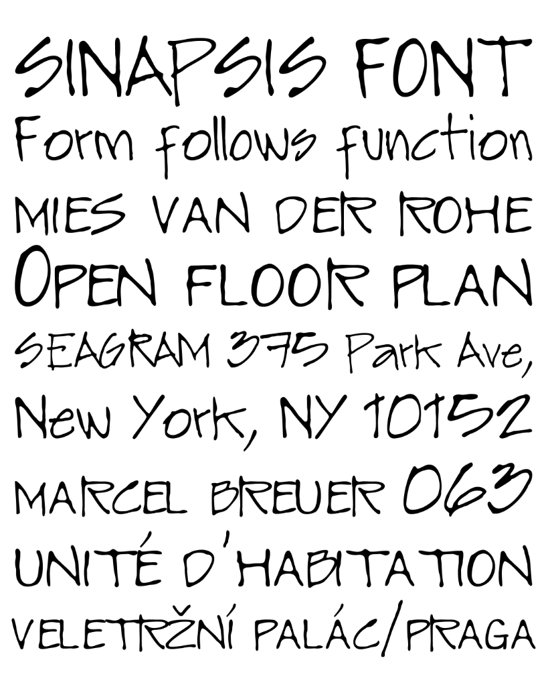

# Sinapsis



**Sinapsis** is an Open Access typeface created for the **Sinapsis Architecture Workshop** at the Facultad del Hábitat, Universidad Autónoma de San Luis Potosí (UASLP). The typeface is based on the architectural handwriting of architect **Juan Fernando Cárdenas Guillén**, who founded the workshop in 2011.

> [!NOTE]
> **Open Access Resource:** Sinapsis is a public good and open educational resource developed for the academic community of the Facultad del Hábitat (UASLP), students, architects, designers, and researchers worldwide. It is distributed under the [SIL Open Font License 1.1](LICENSE.txt), permitting free download, study, adaptation, and redistribution without royalties or licensing fees.

This repository hosts the production font binaries, font engineering toolsets, QA reports, documentation, and release packaging pipelines structured under professional font development and version control standards.

---

## Repository Structure

The project follows a standard modular architecture for font engineering:

```text
Sinapsis_UASLP/
├── assets/                 # Visual documentation, specimens, and graphics
│   └── scans/              # Archival notebook manuscript scans (23 JPG pages)
├── builds/                 # Compiled binaries ready for testing and production
│   ├── otf/
│   │   └── proof/          # Desktop OpenType-CFF binary (FhSinapsis-Regular.otf)
│   ├── ttf/                # TrueType binary (FhSinapsis-Regular.ttf)
│   ├── woff/
│   │   └── proof/          # Web Open Font Format binary (FhSinapsis-Regular.woff)
│   ├── woff2/              # Web Open Font Format 2 binary (FhSinapsis-Regular.woff2)
│   ├── release/            # Clean distribution packages (.zip)
│   └── package_release.sh  # Automated sanitized packaging utility
├── docs/                   # Technical documentation and specifications
│   ├── 00_context.md       # Conceptual foundation, history, and Open Access mission
│   ├── 01_workflow.md      # Digitization pipeline, vectorization, and build workflow
│   ├── 02_nomenclature.md  # OpenType name table architecture and metadata
│   └── 03_releases.md      # Engineering milestones and release history
├── scripts/                # Automated Glyphs Python engineering scripts
│   ├── AjustarMetricasVerticales.py # Vertical metrics adjustment (Google Fonts specs)
│   └── Smooth2Sharp.py     # Bézier contour optimization and node cleanup
├── tests/                  # QA reports (Fontbakery Type Network HTML and vertical metrics PDF)
├── CHANGELOG.md            # Semantic changelog following Keep a Changelog
├── CONTRIBUTORS.md         # Attribution of authors, workshop, and consultants
├── EULA.md                 # End User License Agreement (Markdown)
├── EULA.txt                # Plaintext license agreement for distribution archives
└── LICENSE.txt             # SIL Open Font License 1.1
```

### Documentation & Technical Specifications

* [**00_context.md** (Context & Mission)](docs/00_context.md) — Conceptual origin, architectural background, and Open Access educational mission.
* [**01_workflow.md** (Digitization & Build Workflow)](docs/01_workflow.md) — 9-step digitization pipeline, vectorization, master setup, and font compilation.
* [**02_nomenclature.md** (OpenType Metadata)](docs/02_nomenclature.md) — OpenType name table architecture, weight encoding, and metadata specifications.
* [**03_releases.md** (Release Milestones)](docs/03_releases.md) — Engineering milestones and complete release history.
* [**CHANGELOG.md**](CHANGELOG.md) — Semantic versioning log adhering to Keep a Changelog standards.
* [**CONTRIBUTORS.md**](CONTRIBUTORS.md) — Author, workshop, and institutional credits.
* [**EULA.md**](EULA.md) ([Plaintext EULA.txt](EULA.txt)) — End User License Agreement.
* [**LICENSE.txt**](LICENSE.txt) — SIL Open Font License 1.1 legal terms.

---

## Typographic Style & Scope

Sinapsis is purposefully engineered as a single-style typeface: **Regular** (`Fh-Sinapsis Regular`). The project focuses with maximum fidelity on preserving and translating the singular gesture, organic ductus, stroke weight, and rhythm of Arq. Juan Fernando Cárdenas Guillén's notebook manuscripts.

| Parameter | Value |
| :--- | :--- |
| **Family Name (ID 1 / 16)** | `Fh-Sinapsis` |
| **Subfamily Name (ID 2 / 17)** | `Regular` |
| **Full Font Name (ID 4)** | `Fh-Sinapsis Regular` |
| **PostScript Name (ID 6)** | `FhSinapsis-Regular` |
| **Weight Class (`usWeightClass`)** | `400` (Normal / Regular) |
| **Width Class (`usWidthClass`)** | `5` (Medium) |
| **Target Distribution Formats** | Desktop (`.otf`, `.ttf`), Web (`.woff`, `.woff2`) |

---

## Technical Specifications (Font Specs)

* **Distribution Formats:**
  * **Desktop / Print:** OpenType-CFF (`.otf`) and TrueType (`.ttf`).
  * **Webfonts:** WOFF (`.woff`) and WOFF2 (`.woff2`) with Brotli compression.
* **Units Per Em (UPM):** 1000 UPM.
* **Vertical Metrics (Google Fonts / Type Network standard):**
  * `typoAscender`: 935 | `typoDescender`: -355 | `typoLineGap`: 0
  * `winAscent`: 1060 | `winDescent`: 355
  * `hheaAscender`: 935 | `hheaDescender`: -355 | `hheaLineGap`: 0
  * `Use Typo Metrics` enabled (`fsSelection` bit 7).
* **OpenType Features (GSUB/GPOS):**
  * `calt` — *Contextual Alternates (dynamic letterform alternation to reproduce genuine handwriting rhythm)*
  * `ss01` — *Stylistic Set 1 (alternate lowercase glyphs: a, n, o, s, y, ampersand, ligatures)*
  * `ss02` — *Stylistic Set 2 (terminal variants for uppercase and lowercase forms: E, K, T, a, s)*
  * `liga` — *Standard Ligatures (fi, fl)*
  * `dlig` — *Discretionary Ligatures (architectural cursive pairs: e_n, e_s, s_t, t_i, z_a, C_O, S_P)*
  * `smcp` / `c2sc` — *Small Capitals (complete lowercase and uppercase to small caps conversion)*
  * `case` — *Case-Sensitive Forms (vertically adjusted punctuation and symbols)*
  * `frac` / `numr` / `dnom` — *Arbitrary diagonal fractions, numerators, and denominators*
  * `sups` / `subs` / `sinf` / `ordn` — *Superscripts, subscripts, inferiors, and ordinals*
  * `locl` — *Localized Forms (Catalan punt volat and Turkish dotless/dotted i)*
  * `ccmp` — *Glyph Composition / Decomposition*
  * `kern` — *Horizontal Class-Based Kerning*
  * `aalt` — *Access All Alternates*

---

## Digitization & Development Workflow

The production pipeline translates handwritten sketchbooks into precision digital vectors:

1. **Notebook Scanning (600 DPI):** Flatbed archival optical scanning of physical notebooks and manuscripts at a fixed resolution of 600 DPI.
2. **Photographic Pre-Processing & Reframing (Adobe Photoshop):** Re-framing, canvas cropping, perspective/keystone correction, and tonal contrast equalization.
3. **AI Super-Resolution Upscaling (Upscayl 4x):** 4x neural upscaling to enhance stroke definition and suppress raster noise before vector conversion.
4. **Vector Tracing & Em-Square Scaling (Adobe Illustrator):** Precision contour vector tracing and path optimization, scaled and aligned to the standard 1000 UPM Em square.
5. **Morphological Character Classification:**
   * Segregation of uppercase (majuscules) and lowercase (minuscules) letterforms.
   * Mapping of natural handwritten ligatures and terminal forms.
   * Cataloging of contextual alternate glyph variants (`calt`, `ss01`, `ss02`).
6. **Master Ingestion (Glyphs 3):** Structuring glyph layers, sidebearings, vertical alignment zones, and anchors in the Glyphs 3 master (`Sinapsis.glyphs`).
7. **OpenType Feature Scripting:** Authoring substitution routines (`calt`, `ss01`, `ss02`, `liga`, `dlig`, `smcp`, `c2sc`, `locl`) to maintain dynamic handwriting rhythm.
8. **Quality Assurance (QA) & Compilation:** Testing via *Fontbakery*, vertical metrics auditing, and production compilation to OTF, TTF, WOFF, and WOFF2.

See [`docs/01_workflow.md`](docs/01_workflow.md) for full procedural documentation.

---

## Credits

* **Juan Fernando Cárdenas Guillén** — Original handwriting and conceptual inspiration.
* **Manuel Guerrero Salinas (Bluetypo)** — Digital type design, digitization, vectorization, and font engineering production.
* **Taller de Arquitectura Sinapsis** — Facultad del Hábitat, Universidad Autónoma de San Luis Potosí (UASLP).

---

## Open Access Licensing

**Sinapsis** is released as an **Open Access Resource** under the terms of the **SIL Open Font License, Version 1.1** ([LICENSE.txt](LICENSE.txt)).

* **Commercial & Non-Commercial Use:** Free for personal, educational, research, architectural, editorial, and commercial applications.
* **Open Access Distribution:** Full access to compiled distribution binaries (OTF, TTF, WOFF, WOFF2), engineering scripts, QA reports, and technical documentation.
* **Derivative Works:** Modification and redistribution permitted provided derivatives remain under the OFL and respect the Reserved Font Names (*"Sinapsis"*, *"Fh-Sinapsis"*).
* See the [End User License Agreement (EULA.md)](EULA.md) for comprehensive terms.
