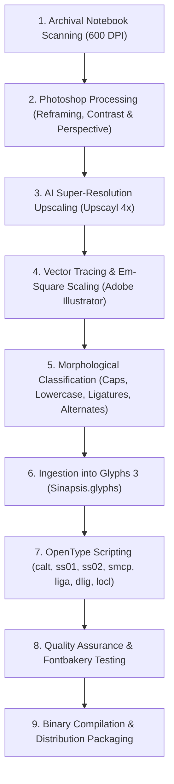

# Type Design Workflow — Sinapsis

> [**← Return to README**](../README.md) · [**00 Context**](00_context.md) · [**01 Workflow**](01_workflow.md) · [**02 Nomenclature**](02_nomenclature.md) · [**03 Releases**](03_releases.md)

---

## 1. Source Material & Digitization Pipeline

The design process originates from the analog architectural notes and manuscripts of Arq. Juan Fernando Cárdenas Guillén (Sinapsis Architecture Workshop, Facultad del Hábitat, UASLP).



### Step 1: Notebook Scanning at 600 DPI
* **Archival Flatbed Scanning:** Physical notebooks and sketchbooks were scanned at a fixed optical resolution of **600 DPI** to preserve authentic analog ink dispersion, pen angle dynamics, and raw stroke textures.
* **Archival Asset Storage:** Original notebook manuscript scans (23 pages) are archived in [`assets/scans/`](../assets/scans/), and typographic specimens are stored in [`assets/`](../assets/) (e.g., [`Sinapsis_specimen.png`](../assets/Sinapsis_specimen.png)).

### Step 2: Photographic Pre-Processing & Reframing in Adobe Photoshop
* **Reframing & Perspective Correction:** Cropping, deskewing, and planar keystone correction to eliminate distortions resulting from notebook binding curvature.
* **Contrast & Tone Optimization:** Levels, curves adjustment, and threshold balancing to separate dark ink deposits cleanly from background paper fibers while preserving natural edge nuances and pressure transitions.

### Step 3: AI Super-Resolution Upscaling with Upscayl (4x)
* **AI-Enhanced Detail Recovery:** Raw captures were processed through **Upscayl AI using a 4x scaling model** to reconstruct fine edge acuity and stroke density.
* **Noise Suppression:** AI interpolation eliminates optical sensor noise and raster artifacts, yielding ultra-high-definition bitmap boundaries essential for accurate vector translation.

### Step 4: Vector Tracing & Em-Square Metric Scaling in Adobe Illustrator
* **Precision Vector Tracing:** Digital contour tracing performed in **Adobe Illustrator**, capturing the cursive energy, connection terminals, and architectural rhythm of the original handwriting.
* **Path Cleanup & Contour Normalization:** Elimination of superfluous nodes, placement of on-curve points at horizontal/vertical tangent extrema, and smooth inflection point alignment.
* **Em-Square Proportional Scaling:** The extracted vector letterforms were scaled and normalized to fit the standard typographic **Em square (1000 UPM coordinate system)**, aligning glyph proportions against standard typographical reference metrics.

### Step 5: Morphological Classification & Character Inventory
* **Case Segregation:** Systematic classification and separation of uppercase (majuscules) and lowercase (minuscules) letterforms.
* **Small Capitals:** Creating proportional small caps (`.sc`) for basic and accented Latin.
* **Ligature Mapping:** Cataloging connected cursive sequences and distinctive architectural ligatures.
* **Contextual Alternate Identification:** Isolating positional and alternating variations to emulate spontaneous freehand lettering through programmatic substitutions (`calt`, `ss01`, `ss02`).

### Step 6: Glyphs 3 Master Ingestion
* **Master Source File:** `Sinapsis.glyphs` (Glyphs 3 design master, maintained separately from the public distribution repo).
* **Editor:** Glyphs 3.x.
* **Master Setup:** Single master **Regular**, setting sidebearings (LSB / RSB), component inheritance, vertical metric alignment zones (Baseline, x-Height, Cap Height, Ascender, Descender), and anchor positioning (`top`, `bottom`, `ogonek`).
* **Vertical Metrics Automation:** Running [`scripts/AjustarMetricasVerticales.py`](../scripts/AjustarMetricasVerticales.py) to configure Typo, Win, and Hhea metrics conforming to Google Fonts / Type Network specifications.

### Step 7: OpenType Feature Engineering & Script Generation
* **Contextual Alternates (`calt`):** Scripting automated contextual substitution lookup tables to rotate alternate glyph variants dynamically across running text, preventing adjacent duplicate glyph collision and reproducing organic handwriting rhythm.
* **Stylistic Sets (`ss01`, `ss02`):** Providing single-story forms (`ss01`) and terminal flourishes (`ss02`).
* **Small Capitals (`smcp`, `c2sc`):** True small capital substitutions from lowercase and uppercase.
* **Standard & Discretionary Ligatures (`liga` / `dlig`):** Multi-glyph substitution syntax for cursive architectural letter pairs.
* **Case-Sensitive Forms (`case`):** Positional shift for punctuation marks, brackets, and math symbols when set in all-caps strings.
* **Fractions & Numerals (`frac`, `numr`, `dnom`, `sups`, `subs`, `sinf`, `ordn`):** Full typographic numeral support.
* **Glyph Composition & Positioning (`ccmp`):** Composed diacritic mark-to-base construction.

---

## 2. Compilation Targets & Output Directory Structure

Compiled binaries are generated into their dedicated directories:

* **Desktop CFF OpenType (.otf):** `builds/otf/proof/FhSinapsis-Regular.otf`
* **Desktop TrueType (.ttf):** `builds/ttf/FhSinapsis-Regular.ttf`
* **Web Open Font Format (.woff):** `builds/woff/proof/FhSinapsis-Regular.woff`
* **Web Open Font Format 2 (.woff2):** `builds/woff2/FhSinapsis-Regular.woff2`
* **Official Distribution Archives:** `builds/release/Sinapsis_v1.0.2.zip`

### Export Configuration Guidelines:
1. **Remove Overlaps:** Enable during export to produce clean composite contours.
2. **Autohinting:** Apply PostScript autohinting for crisp rendering across screen rasters.
3. **Subroutinization (CFF):** Optimize routine calls to minimize `.otf` file sizes.
4. **WOFF2 Brotli Compression:** Compress web fonts with maximum Brotli level for ultra-low latency web delivery.

---

## 3. Quality Assurance (QA)

Before tagging releases or packaging:

1. **Path & Contour Inspection:**
   * Run [`scripts/Smooth2Sharp.py`](../scripts/Smooth2Sharp.py) to clean unnecessary nodes and smooth inflection points.
   * Verify all glyphs pass inflection, missing extrema, and overlapping node checks.
2. **Automated Fontbakery Validation:**
   ```bash
   fontbakery check-universal builds/otf/proof/FhSinapsis-Regular.otf
   ```
3. **Typographic Proofing:**
   * Evaluate editorial typesetting proofs in Adobe InDesign and inspect vertical metrics (`tests/Sinapsis-reporte-metricas-verticales.pdf`).

---

## 4. Release Packaging & Distribution

To prepare a production-grade Open Access distribution package:

1. Export finalized font binaries into `builds/otf/proof/`, `builds/woff/proof/`, `builds/ttf/`, and `builds/woff2/`.
2. Run the automated release packaging utility:
   ```bash
   bash builds/package_release.sh
   ```
3. The script strips operating system metadata (`.DS_Store`, `._*`, `Thumbs.db`), bundles licensing documentation (`LICENSE.txt`, `EULA.txt`, `README.md`), and compiles the sanitized archive into `builds/release/`.
4. Update `CHANGELOG.md` with semantic release notes.
5. Create an annotated Git tag:
   ```bash
   git tag -a v1.0.2 -m "Release v1.0.2"
   git push origin main --tags
   ```
